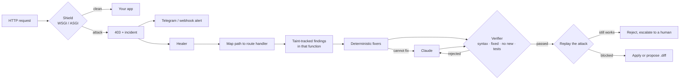

<div align="center">

# 🛡 Aegis

### Self-healing application security

**Aegis blocks an attack in under a millisecond, finds the line of code the attack went through, patches it, and proves the exploit no longer works, usually in 30–50 ms.**

`zero runtime dependencies` · `Flask · Django · FastAPI` · `rules first, Claude second` · `every patch gated`

</div>

---

Most security tools stop at a warning. A scanner gives you a PDF with 200 findings. A firewall blocks the request and the hole stays open. AI code assistants suggest a fix, and you have to trust it.

Aegis closes the loop:

```
 attack ──► 1 DETECT ──► 2 BLOCK ──► 3 LOCATE ──► 4 PATCH ──► 5 VERIFY ──► 6 REPLAY
            0.1 ms       403         the handler   rules, then    4 gates     the real attack
                                     + vulnerable  Claude                     against the
                                     line                                     patched code
```

A patch is accepted only if it passes **all** of these gates:

1. **syntax**: the patched file compiles
2. **fixed**: the vulnerability is gone from that function
3. **no new**: no other vulnerability appeared anywhere in the file
4. **tests**: your own test suite still passes (optional, `--test "pytest -q"`)
5. **replay**: the attack that triggered the healing is replayed against the patched code and has to fail (when a replay function is configured: `aegis demo`, `aegis lab`, or `Healer(replay=...)`)

Gates 1–3 are static: they re-scan the code with the same scanner. They prove the pattern is gone, not that the app still behaves the same. That is what gates 4 and 5, the property tests below, and `propose` mode (a human merges the diff) are for.


Videos: [Aegis Range, real apps behind one gateway (42 s)](docs/aegis-range-demo.mp4) · [VulnShop lab (50 s)](docs/aegis-lab-demo.mp4)

## Results

Reproduce with `python benchmarks/run.py --real-world` (full details in [BENCHMARKS.md](BENCHMARKS.md)).

| | |
| --- | --- |
| Real attacks against the demo shop that worked before | **7 / 7** |
| Blocked by the shield | **7 / 7** |
| Traced to the vulnerable line and patched automatically | **7 / 7** |
| Mean time from attack to verified patch | **30–50 ms** |
| Attacks that still work after healing (shield removed) | **0 / 7** |
| Legitimate requests that work after healing | **8 / 8**, up from 7 / 8: the SQL fix also repaired search for `O'Brien` |
| Shield on its tuning corpus (89 attacks / 146 tricky benign inputs) | **100 % detected / 0 % false alarms**: an upper bound, the corpus includes every bypass found in review |
| Shield on a frozen held-out set written after tuning (30 / 30) | **28 / 30 detected, 0 / 30 false alarms** |
| Noise on 3,000 files of real open-source libraries | 0 critical, 0 high, 0 automatic edits, 0 crashes |

### On real, third-party data and apps ([REAL_WORLD.md](REAL_WORLD.md))

| | |
| --- | --- |
| False alarms on 72,000 normal requests of the public CSIC 2010 dataset (test half never seen while tuning) | **0** |
| SecLists payload lists held out from tuning: LFI / MSSQL injection / XSS | **9→70 % and 63→91 % / 41→82 % / 78→82 %** detected (before → after) |
| sqlmap against DSVW (a real vulnerable app by sqlmap's author): unprotected → behind Aegis Gateway | **table dumped → "not injectable"**, also with `--random-agent --tamper --level 3` |
| Same sqlmap run after Aegis healed the code, **with no shield at all** | **"not injectable"** |
| Holes healed live in other people's code (DSVW, vulpy) | SQL injection ×4, command injection, path traversal ×2, a login bypass whose sink was in a helper module |

## Why this is different

| | Finds the bug | Stops the live attack | Fixes the code | Proves the fix |
| --- | :-: | :-: | :-: | :-: |
| Static scanners (SAST) | ✅ | — | — | — |
| Web application firewalls | — | ✅ | — | — |
| AI coding assistants | sometimes | — | ✅ unverified | — |
| Autonomous cyber reasoning systems (e.g. DARPA AIxCC finalists) | ✅ | — | ✅ | ✅ (offline, before release) |
| **Aegis** | ✅ | ✅ | ✅ | ✅ **in production, at the moment of attack** |

The DARPA AI Cyber Challenge showed that AI can find and patch vulnerabilities on its own. Those systems work **offline**: they fuzz a codebase before release. Aegis takes the same idea to the place where most small companies actually get hurt: a **live web app**, at the moment it is attacked, with nobody on the security team because there is no security team.

## Quick start

```bash
git clone https://github.com/facei7505-droid/aegis && cd aegis
pip install -e ".[demo]"                # Python 3.10+, the core itself has no dependencies

aegis demo                              # watch the whole loop, writes aegis-demo-report.html
aegis lab                               # run the vulnerable shop on localhost and attack it yourself:
                                        # 1st attack works, Aegis patches, the server reloads, 2nd attack fails
aegis scan .                            # find vulnerabilities
aegis fix . --dry-run                   # show verified patches, change nothing
aegis fix . --test "pytest -q"          # apply them, but only if your tests still pass
aegis range                             # real vulnerable apps from GitHub behind one Aegis Gateway
aegis gateway -c gateway.toml           # protect your own apps (any language) from one server
```

With Claude for everything the rules cannot fix (your key never leaves your machine except to Anthropic's API):

```bash
export ANTHROPIC_API_KEY=sk-ant-...     # Windows PowerShell: $env:ANTHROPIC_API_KEY="sk-ant-..."
aegis fix . --ai --test "pytest -q"
aegis scan . --ai-triage --lang ru      # Claude confirms each finding and explains it for a business owner
```

### Protect a running app (one line)

```python
from aegis.integrations import protect

protect(app)            # Flask: block attacks, alert, write verified patches to .aegis/patches/
```

```python
from aegis.integrations import protect_asgi, protect_wsgi

app = protect_asgi(app)                                   # FastAPI / Starlette
application = protect_wsgi(get_wsgi_application())        # Django (wsgi.py)
```

Environment variables: `AEGIS_MODE=block|monitor`, `AEGIS_HEAL=propose|auto|off`, `AEGIS_TELEGRAM_TOKEN` and `AEGIS_TELEGRAM_CHAT` for instant alerts, `AEGIS_WEBHOOK_URL` for Slack and other webhooks, `AEGIS_LOG=incidents.jsonl`.

### Protect many apps from one server

```toml
# gateway.toml — see docs/GATEWAY.md
[[app]]
name = "shop"
upstream = "http://127.0.0.1:5101"
hosts = ["shop.localhost"]
source = "./shop"        # Python source enables healing; leave it out for apps in other languages
heal = "propose"
```

`aegis gateway -c gateway.toml` puts a shield in front of every app, a healer behind every Python app, and a live dashboard at `http://localhost:8080/`.

**Production default is `heal="propose"`:** Aegis writes a verified `.diff` for a human to merge instead of rewriting code on a live server. `auto` exists for staging, demos and teams that want it.

## How it works



- **Scanner** (`aegis/scanner`): parses Python with `ast` and tracks attacker-controlled data (query, form, JSON, cookies, headers, Flask/FastAPI path parameters, Django `request.GET/POST`) through assignments, f-strings, concatenation and calls, until it reaches a dangerous sink. Sanitizers (`int()`, `html.escape`, `os.path.basename`, `secure_filename` and others) end the taint. Severity depends on whether the data is really attacker-controlled.
- **Patcher** (`aegis/patcher`): deterministic fixers rewrite the exact AST span and keep the file's own style (quotes, import order). When in doubt they refuse and escalate. SQL is parameterized only in value positions and only when the driver's placeholder style is known from the file's imports. Shell strings become argument lists only without pipes, globs or expansions, and never when the request picks the program. A variable assigned on two paths is never half-fixed. Fixes that change behaviour (`eval` to `literal_eval`, shell to argv) run only when taint analysis says the input comes from the request. Configuration fixes (secrets to environment variables, `yaml.safe_load`, `debug=False`) are applied regardless, and the secret fix means the app needs that variable set before it starts.
- **AI engine** (`aegis/ai`): Claude sees one function, the finding and the verifier's feedback. The proposal must be that one function and nothing else (same name, signature, decorators). Imports come from an allow-list and may not shadow builtins. A proposal that adds capabilities the original did not use (`eval`, `os.environ`, sockets, HTTP clients, new routes) is rejected. Then it goes through the same gates as rule patches. `--test` runs your tests against the candidate in a temporary copy of the project, so the real file changes only after every gate passes (and never with `--dry-run`). Your tests do execute the candidate: run AI + `--test` in CI or a container.
- **Shield** (`aegis/shield`): normalizes input (repeated URL decoding, HTML entities, SQL comment padding), scores 10 attack classes (SQLi, XSS, path traversal, command, template and code injection, SSRF, header injection, XXE, format strings) as independent evidence, uses a relaxed threshold for password fields, auto-bans repeat offenders, alerts without blocking the request thread, and logs incidents as JSON Lines. It inspects query, path, headers, cookies, form, JSON and every text field of multipart forms (streamed, so a large upload placed first cannot hide a field). A body it cannot parse is inspected as raw text, never skipped. On an internal error it fails open by default (`fail_open=False` to refuse instead).
- **Healer** (`aegis/healer.py`): maps the blocked request to its route (Flask `<int:id>`, FastAPI `{id}`, blueprints and routers mounted under a prefix when exactly one route fits). It never guesses: an ambiguous request stays blocked and goes to a human. It selects only the rules that match the attack class, patches, verifies, replays when configured, and applies or proposes. A finding it could not fix is not re-analysed on every request (10-minute cooldown), so an attack flood cannot multiply Claude calls.

## Rules

| ID | Vulnerability | CWE | Automatic fix |
| --- | --- | --- | --- |
| AEG001 | SQL injection | CWE-89 | parameterized query (`?` or `%s` chosen by driver) |
| AEG002 | OS command injection | CWE-78 | argument list without a shell |
| AEG003 | Code injection (`eval`/`exec`) | CWE-95 | `ast.literal_eval` (user input only) |
| AEG004 | Insecure deserialization | CWE-502 | `yaml.safe_load`; pickle → Claude / human |
| AEG005 | Path traversal | CWE-22 | `os.path.basename` on the user part |
| AEG006 | Hardcoded secret | CWE-798 | read from environment (+ rotate) |
| AEG007 | Debug mode | CWE-489 | `debug=False` |
| AEG008 | Reflected XSS | CWE-79 | `html.escape` on user values only |
| AEG009 | Server-side template injection | CWE-1336 | pass data as Jinja variables |
| AEG010 | Weak hash | CWE-328 | Claude / human (needs a migration) |
| AEG011 | SSRF | CWE-918 | Claude / human (needs an allow-list) |

## CI/CD

- **GitHub Action**: `uses: facei7505-droid/aegis@v1`. Results appear in GitHub Code Scanning (SARIF 2.1.0), and verified patches go to the job summary.
- **pre-commit**: hook id `aegis`.
- **Exit codes**: `aegis scan --fail-on high` returns 1 when something at that level is found.
- **Baseline** for legacy code: `aegis baseline` once, after that CI fails only on *new* problems.
- **Suppress** a reviewed line: `# aegis: ignore[AEG006]`.
- **Outputs**: `--format text | json | sarif | markdown | html` (the HTML report comes in English or Russian with `--lang ru`).

```toml
# pyproject.toml
[tool.aegis]
exclude = ["migrations/*"]
disable = ["AEG010"]
fail_on = "high"
baseline = ".aegis-baseline.json"
language = "ru"
```

## Independent review

A separate reviewer agent tried to break Aegis: 18 confirmed findings, from a shield bypass to AI guardrail gaps. All 18 are fixed, each with a regression test: see [REVIEW.md](REVIEW.md). What is still open is listed right below.

## Limitations (read before you trust it)

- **Python only** for code analysis. The shield protects any WSGI/ASGI app.
- **Taint tracking is intra-procedural.** Data that flows through helper functions in other modules can be missed. Stored XSS (attacker data saved to the DB and rendered later) is not tracked. Django and FastAPI coverage is narrower than Flask (`HttpResponse`, `HTMLResponse` and `FileResponse` are covered; class-based views and DRF are not yet).
- **Argument injection.** An argument list stops shell injection, but a value starting with `-` can still be read as an option by the program (`curl`, `tar`). Aegis does not add `--` for you.
- **Path fixes use `os.path.basename`.** Safe, but it also drops legitimate sub-folders in the user's part. Containment checks with `realpath` are on the roadmap.
- **The shield is signature-based** with normalization. It is not a replacement for a mature WAF against a determined attacker, and its corpora are small (see BENCHMARKS.md, including the held-out misses). Signatures are the first layer; fixing the code is the point.
- **Self-healing on a live server** patches the source file. Your process still needs a reload, or a deploy for `propose` mode, before the fix is live. Until then the shield keeps blocking.
- The demo app is synthetic. The next milestone is pilots on real codebases.

## Roadmap

- Inter-procedural taint and stored-XSS tracking
- JavaScript/TypeScript (Express, Next.js) support
- Hot reload with canary traffic after an `auto` heal
- Independent evaluation on public payload corpora and the OWASP Benchmark
- Dashboard for incidents and pending patches

## Development

```bash
pip install -e ".[dev]"
pytest -q                     # 280+ tests, incl. property tests on 300 SQL queries and 200 shell commands
python benchmarks/run.py      # regenerates BENCHMARKS.md
aegis scan .                  # Aegis scans itself in CI
```

## Responsible use

Aegis is a defensive tool. `VulnShop` (`aegis/demo_app`) is vulnerable on purpose and must never be deployed. Only test systems you own or have written permission to test.

## Author

**Magzhan Koilybai** · Shymkent, Kazakhstan · Telegram [@makakke4](https://t.me/makakke4)

Built with AI pair-programming (Claude by Anthropic). Design decisions, testing and the product direction are documented in [docs/ARCHITECTURE.md](docs/ARCHITECTURE.md).

MIT License.
